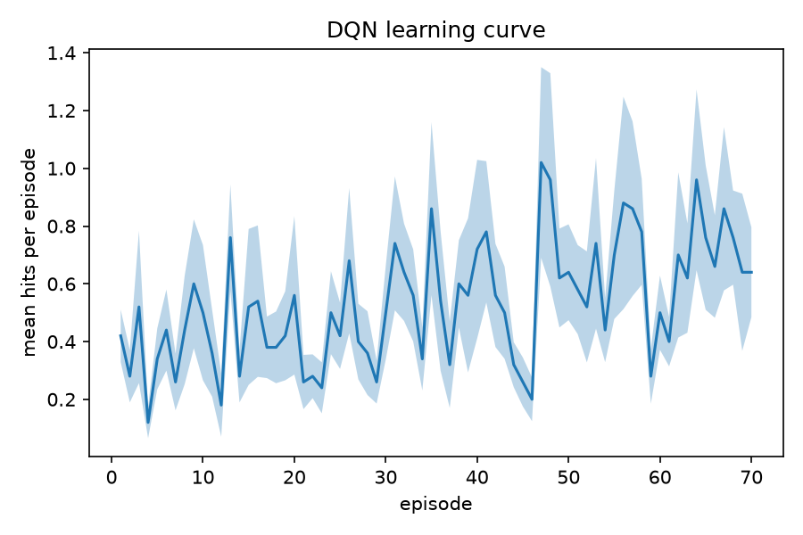

# Rigor Review of Organoid Intelligence Research

This repo has two parts: the working files for a critical review of how rigorous organoid intelligence (OI) and biocomputing research is, and a Pong replication I am using to test the same ideas on one paper.

## Overview

OI claims that living neurons can compute or learn, sometimes more efficiently than AI. Our group first planned an argumentative paper. About a month ago we changed it to a metascience review: instead of arguing for or against OI, we check how well the field's claims are supported. The questions are:

- Does each claim match the system that was actually tested (2D cultures vs organoids, whole brain vs organoid)?
- Are the controls, statistics and comparisons to AI fair?
- Do reviews and company pages keep the original authors' caveats, or drop them?
- Has anyone outside the original team reproduced the result?

My part is the rubric and scoring workbook, and an audit of the efficiency and accuracy claims versus AI (measured vs projected, same task, same metric, full energy accounting).

## Process right now

1. Search by a written protocol, set before searching ([search_protocol.md](oi-review/search_protocol.md)). Papers are picked for making a claim, not for quality.
2. Log every record with a decision and reason code, and keep counts for a flow diagram.
3. Score each paper with the rubric, 0 / 1 / 2 / NA per item. Empirical papers get 9 items; reviews, roadmaps and company pages get 4 ([anchors](oi-review/rubric_scoring_anchors_v1.md)). Two raters score separately and settle differences.
4. Log individual claims and tag them: demonstrated, demonstrated under constraints, projected, illustrative, aspirational, not demonstrated.
5. Sort papers into High, Medium and Low tiers by mean score, compare within each tier, write the findings, then look for the item that best separates the tiers.

## Where it stands

- Rubric v1 and the workbook are built. The protocol, screening log and source list are done for the first search pass.
- Screening was title and abstract only, by one screener. A second screener still needs to check a random 20% and the full text of every Include and Maybe.
- The workbook has almost no scores yet. Nothing here is a finding.
- Citation chaining from the seed papers is not done.
- The tier cut-offs and the "determining factor" are still open. Tiers use the same scores as the factor, so I will re-tier with each item left out and call the result exploratory.

Next: score 5 or 6 papers with two raters, fix the rubric and cut-offs, pre-register on OSF, then score the rest.

## Files

- `oi-review/OI_Critical_Review_Scoring_Sheet.xlsx`: screening log, scoring sheets, tiers, claims, analysis
- `oi-review/search_protocol.md`: question, searches, include and exclude rules
- `oi-review/rubric_scoring_anchors_v1.md`: what 0, 1 and 2 mean for each item
- `oi-review/review_sources.md`: papers in the screening log, with links
- `pong_env.py`, `dqn.py`, `analyze.py`, `DEVIATIONS.md`: the Pong replication below

## Pong replication (DQN baseline)

Early replication attempt of the DQN side of Khajehnejad et al. (2024), *Biological Neurons Compete with Deep Reinforcement Learning in Sample Efficiency in a Simulated Gameworld* (arXiv:2405.16946). The paper compares DishBrain neuron cultures to DQN, A2C and PPO on simplified Pong.

**Status:** working baseline, not a verified replication. The environment is my reconstruction because the paper does not fully specify it, and I have not compared my numbers to the paper's or to its OSF code. Every assumption is logged in [DEVIATIONS.md](DEVIATIONS.md).

### Result

DQN, full-state input, 70 episodes per run, 50 seeds, epsilon decay over 300 steps. Early = episodes 1-17, late = 18-70, paired t-test across seeds.

| Metric | Early | Late | p |
|---|---|---|---|
| Hits per episode | 0.41 | 0.57 | < 0.001 |
| % aces | 78.8 | 72.3 | 0.001 |
| % long rallies (3+ hits) | 4.1 | 5.9 | 0.010 |

For scale, a random policy gets 0.28 hits and 82% aces.

### Bug I fixed

My first build gave the agent only the difference between consecutive states, so it could not see where the ball was relative to the paddle. DQN got worse (15 seeds, hits 0.38 to 0.29, p = 0.021). Adding the current state to the difference fixed it. `--diff-only` reproduces the broken version. I have not checked how the original code handles position.

### Caveats

- The effect is modest and noisy. Per-seed mean hits range from about 0.2 to 1.5, and short runs differ across machines. Use the 50-seed numbers.
- A random policy aces 82% of the time here but only about 50% in Kagan's controls, so my environment is harder. Compare changes, not levels.
- Epsilon decay, Adam, MSE, the third conv layer and the Pong dynamics are my choices.
- Stats are paired t-tests across seeds with no correction for three metrics, and no effect sizes or confidence intervals yet.
- Only full-state input is evaluated. Image mode runs but is untested. A2C, PPO and the DishBrain comparison are not implemented.

### Run it

`--obs` is `image`, `full` or `ball`. Smoke test: `python dqn.py --seeds 2 --obs ball --out results\smoke.csv`

### Pong files

- `pong_env.py`: Gymnasium Pong, 40x40 grid, 3 observation modes
- `dqn.py`: DQN training with the paper's appendix hyperparameters
- `analyze.py`: the paper's three metrics, early vs late, plus a learning curve
- `DEVIATIONS.md`: every difference from the paper

### Next

Compare to the paper's reported DQN numbers, check the OSF code for input and epsilon, evaluate image mode, add A2C and PPO, report effect sizes with confidence intervals.
